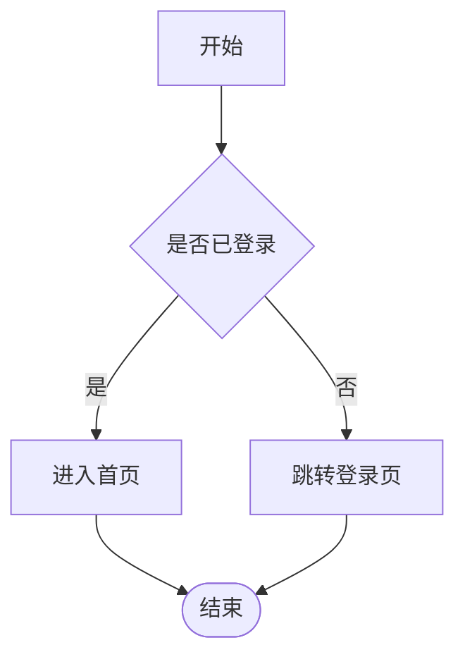
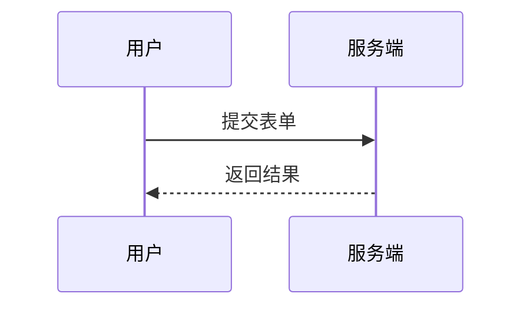

# Mermaid 与 LaTeX 渲染测试

## 一、行内公式

质能方程 $E = mc^2$ 是最著名的公式之一，欧拉恒等式 $e^{i\pi} + 1 = 0$ 同样优雅。

行内代码 `$not_math$` 不应被渲染成公式，金额 $100 与 $200 也不应误判。

## 二、块级公式

$$
E = mc^2
$$

$$
\begin{aligned}
a^2 + b^2 &= c^2 \\
\int_0^1 x^n \, dx &= \frac{1}{n+1}
\end{aligned}
$$

## 三、Mermaid 流程图



## 四、Mermaid 时序图



## 五、普通代码块

```python
def hello(name):
    # 中文注释也不会丢失
    return f"你好，{name}"
```

## 六、表格与列表

| 场景 | 公式 | 说明 |
| --- | --- | --- |
| 均值 | $\bar{x} = \frac{1}{n}\sum x_i$ | 样本均值 |
| 方差 | $s^2 = \frac{1}{n}\sum (x_i - \bar{x})^2$ | 样本方差 |

1. 有序列表含公式 $a^2 + b^2 = c^2$
2. 有序列表第二项包含 **加粗**、*斜体* 与 `行内代码`

- 无序列表含公式 $\lim_{x \to 0} \frac{\sin x}{x} = 1$
- 无序列表第二项
